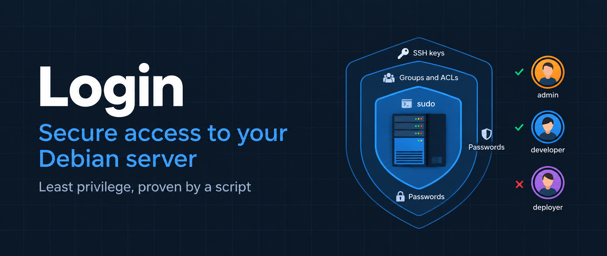
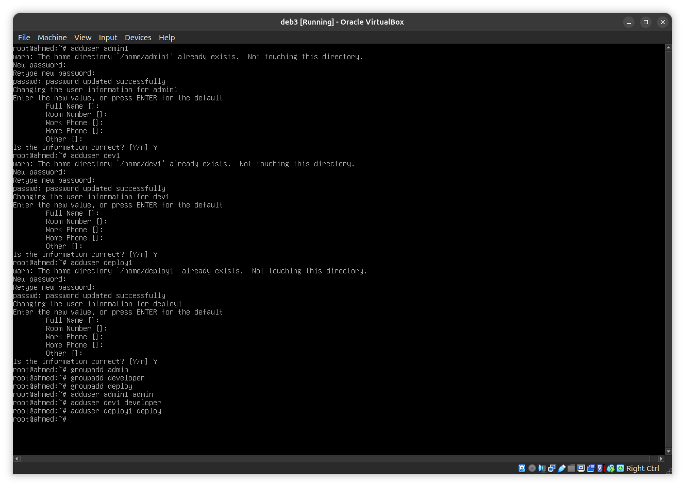
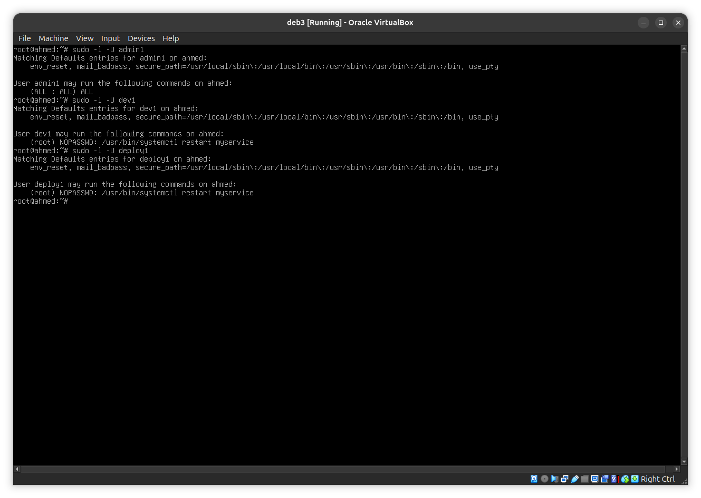
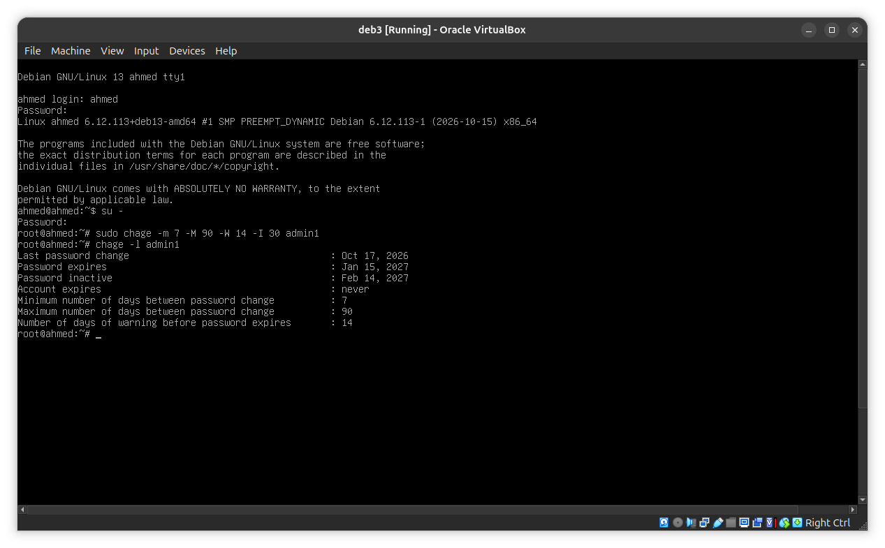
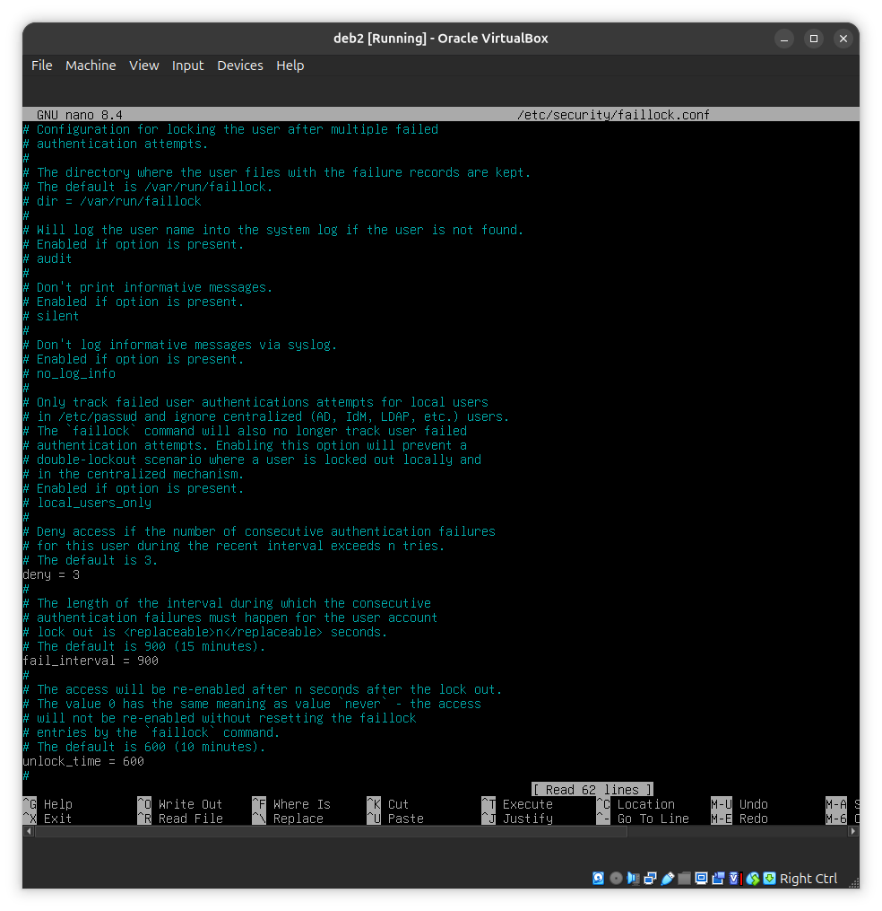
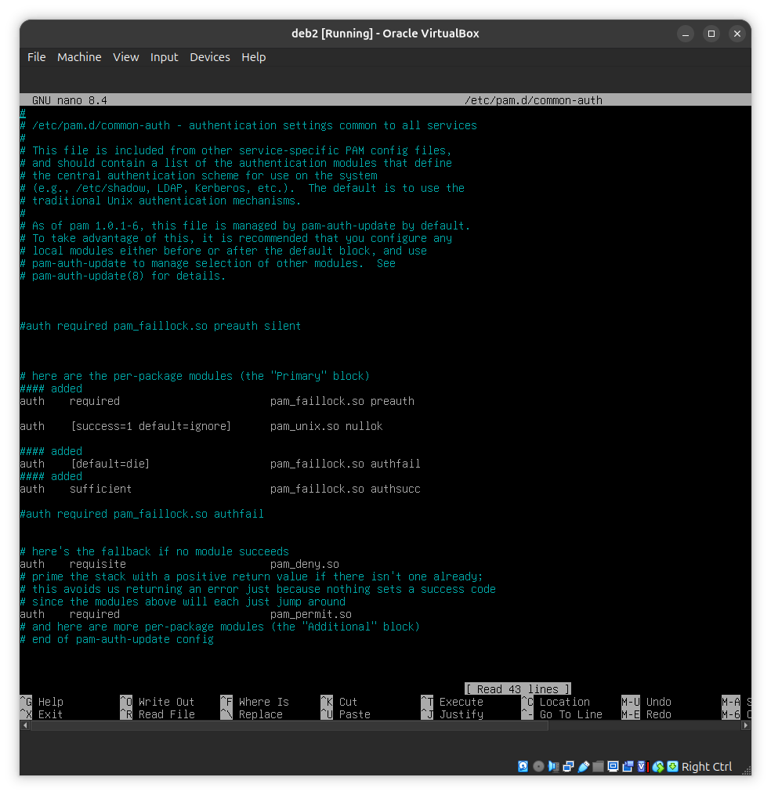
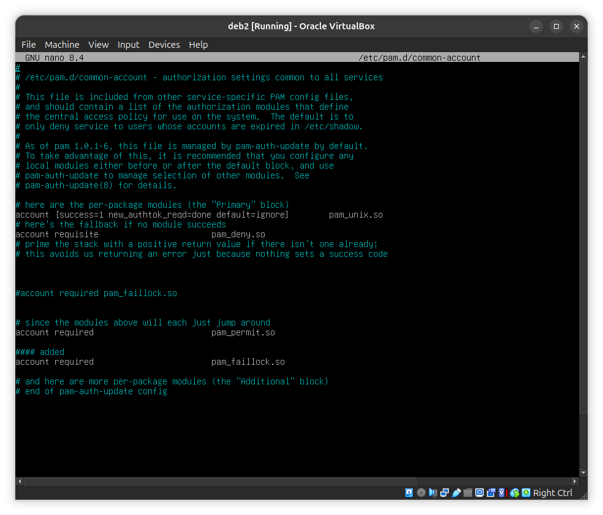
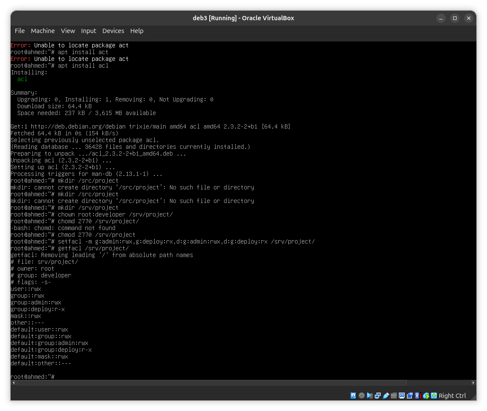

# Structure Of Readme File

01 — Project Overview
02 — System Prerequisites
03 — Users and Role Groups
04 — Sudo Privileges Configuration
05 — Password and Account Security
    05.1 — Password Expiration Management (chage)
    05.2 — Login Failure Protection (PAM)
06 — Shared Storage and Directory Management
    06.1 — Project Workspace
    06.2 — Temporary Workspace
    06.3 — Permission Mechanisms Comparison
07 — SSH Service Security
08 — Verification Script
09 — Repository Structure
10 — Conclusion

# OverView
This project is based on the [Linux project](https://github.com/ahtalbi/Linux-Sysadmin.git). We continue on the same Debian server that was built there, including the systemd service that was created in that project. The service is the one the roles are allowed to restart.

## Goal
A server where everyone logs in as root is not administered, it is only switched on. The goal is to give each person **exactly the access their role needs, and nothing more** (the principle of least privilege), and then to **prove it with a script**.

## What we have to build
- **SSH keys:** one key per user, and password login disabled.
- **Groups and ACLs:** a shared project folder where the writers group can edit and the readers group can only read.
- **sudo rules:** one file per role in `/etc/sudoers.d/`, limited to specific commands.
- **Password policy:** passwords expire (`chage`) and accounts lock after repeated failures (`pam_faillock`).
- **Scratch directory:** a shared folder where users can delete only their own files (sticky bit).
- **Verification script:** `verify.sh` tries every forbidden action and checks that it is denied.

# Users and Role Groups

Here we initialized the users and added one group for every role, as shown in the image:



## The team

| Role | User | Role group |
|---|---|---|
| admin | `admin1` | `admin` |
| developer | `dev1` | `developer` |
| deploy | `deploy1` | `deploy` |

## Add users to theire groups

```bash
adduser admin1 admin
adduser dev1 developer
adduser deploy1 deploy
```
## Check The groups

```bash
id admin1
id dev1
id deploy1
getent group admin developer deploy
```

### Sudo Configuration

Privileges are not written in `/etc/sudoers`. Each role group gets its own file in `/etc/sudoers.d/`, and every file is checked with `visudo`.

| File | Content |
|---|---|
| `/etc/sudoers.d/admin` | `%admin ALL=(ALL:ALL) ALL` |
| `/etc/sudoers.d/developer` | `%developer ALL=(root) NOPASSWD: /usr/bin/systemctl restart myservice` |
| `/etc/sudoers.d/deploy` | `%deploy ALL=(root) NOPASSWD: /usr/bin/systemctl restart myservice` |

Created with:

    visudo /etc/sudoers.d/admin
    visudo /etc/sudoers.d/developer
    visudo /etc/sudoers.d/deploy

Least-privilege rules:

- Privileges are granted to groups, never directly to users.
- Only `admin1` has full privileges, through `%admin ALL=(ALL:ALL) ALL`.
- Nobody is in the `sudo` group: on Debian it already grants `ALL=(ALL:ALL) ALL` and would override any scoped rule.
- Command-scoped rules only: developer and deploy can run only `/usr/bin/systemctl restart myservice`.


## to run sudo you must install it
```
apt install sudo
```

Verify with:

    sudo -l -U admin1
    sudo -l -U dev1
    sudo -l -U deploy1

Only `admin1` has full privileges. Any other role showing them is a policy failure.



## to test acces the users with
```
su - admin1 ## then any command should work
su - dev1 ## then only the restart should work
```

### Password Policy

Two rules protect the passwords of the users: they expire after a set number of days (`chage`), and accounts lock after repeated failed logins (PAM).

#### Password Expiration (chage)

Password aging is set per user with `chage`. It updates the aging fields in `/etc/shadow`, so the file is never edited by hand.

Command used:

    sudo chage -m 7 -M 90 -W 14 -I 30 <username>

| Option | Value | Meaning |
|---|---|---|
| `-m` | 7 | minimum days before the user may change the password again |
| `-M` | 90 | maximum days a password stays valid |
| `-W` | 14 | days of warning before the password expires |
| `-I` | 30 | days after expiry before the account is disabled |

Useful commands:

- Check the aging rules of a user: `sudo chage -l <username>`
- Change only the maximum age, for example: `sudo chage -M 90 <username>`

Example of one user:
    sudo chage -m 7 -M 90 -W 14 -I 30 admin1

Verify with `sudo chage -l <username>`:




# Configuring PAM

To configure PAM, we need to change 3 files.

## 1 - /etc/security/faillock.conf

Uncomment these lines (remove the `#` at the start):

```
deny = 3
unlock_time = 1200
fail_interval = 900
```

Explanation:

```
deny = 3: lock after 3 failed attempts
unlock_time = 1200: locked for 1200 seconds (20 minutes)
fail_interval = 900: the 3 failures must happen within 15 minutes (adjust if your spec says otherwise)
```


## 2 - /etc/pam.d/common-auth

First of all, be careful: if you make a mistake in this file, your system can lock you out. So before editing it, keep a second terminal open (with a root session) in case something goes wrong, and make a backup copy of the file:

```
sudo cp /etc/pam.d/common-auth /etc/pam.d/common-auth.bak
```



## 3 - /etc/pam.d/common-account

It should look something like this:



## Checking and resetting failed attempts

To check failed attempts and get more details, use the `faillock` command:

```
faillock
faillock --user username
```

To reset a user who has been locked out, run:

```
faillock --user username --reset
```

# Configuring the Shared Directory
### Shared Directories

| Folder | Who can do what |
|---|---|
| `/srv/project` | `admin` and `developer` read and write, `deploy` reads only, everyone else has nothing |
| `/srv/scratch` | everyone can create files, each user can delete only their own |

#### Project Directory

    apt install acl
    mkdir /srv/project
    chown root:developer /srv/project
    chmod 2770 /srv/project
    setfacl -m g:admin:rwx,g:deploy:rx,d:g:admin:rwx,d:g:deploy:rx /srv/project

| Command | Job |
|---|---|
| `chown root:developer` | the folder belongs to the `developer` group |
| `chmod 2770` | setgid (`2`): new files keep the group. Group has full access (`77`), others have nothing (`0`) |
| `setfacl -m g:admin:rwx,g:deploy:rx` | `admin` gets read and write, `deploy` gets read only |
| `d:` entries | default ACL: new files copy the same rules, so no `chmod` is needed |

Check:

    getfacl /srv/project



Test:

    sudo -u dev1 sh -c 'echo "from dev1" > /srv/project/f.txt'
    sudo -u admin1 sh -c 'echo "edited by admin1" >> /srv/project/f.txt'
    sudo -u deploy1 cat /srv/project/f.txt
    sudo -u deploy1 sh -c 'echo x >> /srv/project/f.txt'

| Command | Expected |
|---|---|
| `dev1` creates a file | works |
| `admin1` edits it | works |
| `deploy1` reads it | works |
| `deploy1` writes to it | Permission denied |

#### Scratch Directory

    mkdir /srv/scratch
    chmod 1777 /srv/scratch

The `1` is the sticky bit: only the owner of a file can delete it. Everyone can still create files (`777`).

Check:

    ls -ld /srv/scratch

Expected: `drwxrwxrwt`. The `t` is the sticky bit.

Test:

    sudo -u dev1 touch /srv/scratch/dev1.txt
    sudo -u deploy1 rm /srv/scratch/dev1.txt
    sudo -u dev1 rm /srv/scratch/dev1.txt

| Command | Expected |
|---|---|
| `deploy1` deletes `dev1`'s file | Operation not permitted |
| `dev1` deletes their own file | works |

#### Permission Mechanisms

| Mechanism | Where | Why |
|---|---|---|
| Role groups | all folders | access is managed by adding or removing users |
| `770` | `/srv/project` | nothing for anyone outside the groups |
| setgid (`2`) | `/srv/project` | new files keep the `developer` group |
| Named group ACL | `/srv/project` | gives `admin` write and `deploy` read only, which standard permissions cannot express |
| Default ACL (`d:`) | `/srv/project` | new files are group-writable without `chmod` |
| Sticky bit (`1`) | `/srv/scratch` | users delete only their own files |

### SSH Service Security

Each user logs in with their own key pair. Password login is disabled in the SSH server.

#### Keys

On my computer, one key per user:

    ssh-keygen -t ed25519 -f ~/.ssh/admin1_key
    ssh-keygen -t ed25519 -f ~/.ssh/dev1_key
    ssh-keygen -t ed25519 -f ~/.ssh/deploy1_key

The public key of each user goes to the server, into that user's `~/.ssh/authorized_keys`:

    ssh-copy-id -p 2222 -i ~/.ssh/admin1_key.pub admin1@127.0.0.1
    ssh-copy-id -p 2222 -i ~/.ssh/dev1_key.pub dev1@127.0.0.1
    ssh-copy-id -p 2222 -i ~/.ssh/deploy1_key.pub deploy1@127.0.0.1

Every key was tested before passwords were disabled:

    ssh -i ~/.ssh/dev1_key dev1@localhost

#### Disable password login

File: `/etc/ssh/sshd_config.d/99-hardening.conf`

    PasswordAuthentication no
    KbdInteractiveAuthentication no
    PubkeyAuthentication yes

| Setting | Meaning |
|---|---|
| `PasswordAuthentication no` | no login with a password |
| `KbdInteractiveAuthentication no` | closes the other password-style login method |
| `PubkeyAuthentication yes` | keys are the only way in |

Apply and check:

    sshd -t
    systemctl reload ssh
    sshd -T | grep passwordauthentication

#### Proof

    ssh -i ~/.ssh/dev1_key dev1@VM_IP            # works
    ssh -o PubkeyAuthentication=no dev1@VM_IP    # Permission denied (publickey)

Because passwords are disabled over SSH, the lockout rule (`pam_faillock`) applies to local logins only: console, `su` and `sudo`.